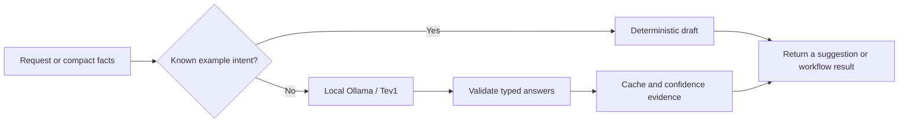

# Aiden Decisions

[](https://github.com/HumanMeatSack/aiden-decisions/actions/workflows/tests.yml)
[](LICENSE)

**Ask small questions locally. Build workflows from the answers. Measure when they are wrong.**

Aiden Decisions wraps Ollama's native decision endpoint with typed questions,
validated answers, caching, bounded decision graphs and optional MCP tools.
The Python core has **no third-party runtime dependencies**.

It grew out of a local assistant project inspired by Jev's decision interface.
It uses Together AI's **Tev1** through **Ollama**; it does not contain Jev's
weights or reproduce its undisclosed architecture. No model weights are bundled.

## Try it

Install Python 3.11+ and [Ollama](https://ollama.com/download) with decision-model
support. Tev1's model card requires Ollama 0.35 or later; a real decision request,
rather than a health check alone, verifies compatibility.

```sh
git clone https://github.com/HumanMeatSack/aiden-decisions.git
cd aiden-decisions
python3 -m venv .venv
source .venv/bin/activate
python -m pip install .
ollama pull tev1:4b-q4_K_M
aiden-decisions serve
```

Open **http://127.0.0.1:8841/** for the interactive demo. On Windows, activate
`.venv\Scripts\activate` instead. If the port is occupied, use `serve --port 8842`.

For a first result without downloading a model:

```sh
aiden-decisions preflight "turn the living room TV on"
```

That example uses the bundled **fictional intent catalog** and makes zero model
calls. It returns a draft intent; it does not connect to a TV.

## What you get

| Feature | Behavior |
| --- | --- |
| Typed questions | `choice`, `noul` (probability of true), and ordered `score` rubrics |
| Batch inference | Related questions share one native model request |
| Workflows | Dependencies, conditional branches and deterministic `all`/`any` rules |
| Cache | Bounded in-memory cache; model digest, input and option order affect reuse |
| Uncertainty | Raw probabilities, review flags and optional fingerprinted calibration |
| Interfaces | Python, CLI, local HTTP demo and five optional read-only MCP tools |
| Local operation | Literal loopback endpoints, no cloud fallback or request-text logs |



### Ask several questions

```python
from aiden_decisions import DecisionEngine

engine = DecisionEngine()
result = engine.decide({
    "state": "My card was charged twice. Please refund the extra payment.",
    "questions": {
        "queue": {
            "type": "choice",
            "instructions": "Choose the support queue.",
            "criteria": {"billing": "Payments or refunds", "other": "Other issues"},
        },
        "refund": {"type": "noul", "instructions": "Is a refund explicitly requested?"},
    },
})
print(result["answers"])
```

### Run a decision graph

```sh
aiden-decisions workflow --file examples/refund_workflow.json
aiden-decisions decide --file examples/support_ticket.json
```

The example batches independent questions, applies a fixed policy and evaluates
a conditional follow-up. It classifies a refund request; it cannot issue a refund.

### Connect an MCP client

```sh
python -m pip install '.[mcp]'
aiden-decisions-mcp
```

Keep the HTTP service running in a separate terminal. Configure your client's
stdio command to the installed `aiden-decisions-mcp` executable. The five tools
are `classify_or_score`, `route_request`, `decision_preflight`,
`run_decision_workflow` and `decision_health`.

[Client configuration and optional Codex hooks](docs/INTEGRATIONS.md) ·
[Architecture and API](docs/ARCHITECTURE.md) ·
[Evaluation and limitations](docs/EVALUATION.md)

## Confidence means evidence, not certainty

A concentrated model distribution is not a measured chance of being right.
Calibration is opt-in, tied to the exact model and ordered question map, and
limited to its evaluated task. No personal calibration profile ships by default.
Graphs cannot intercept an assistant's internal reasoning. The engine has no
device drivers, credentials, shell executor or authority to carry out a suggestion.

The included synthetic corpora are reproducible diagnostics, not evidence of
general accuracy or superiority over Jev. See the evaluation document for results
from this exact standalone export and the failed gates that remain disabled.

## Develop

```sh
python -m pip install '.[mcp]'
python -m unittest discover -s tests -v
python scripts/check_release.py
python scripts/benchmark_decisions.py
```

Unit tests use synthetic backends and need no model, hardware or cloud account.
The benchmark uses local Ollama and does not operate devices.

The initial standalone release passed 65 unit checks and a separate 61-check
core-only installation. Its fixed smoke benchmark matched 53/56 examples; these
are small synthetic diagnostics. [Full results and limitations](docs/EVALUATION.md)
include the misses and the calibration gates that stayed disabled.

## Credits

- [Ollama native decisions](https://docs.ollama.com/capabilities/decision)
- [Tev1 model and limitations](https://ollama.com/library/tev1)
- [Together AI's training code](https://github.com/togethercomputer/tev1)
- [TypeSafe's Jev interface](https://docs.typesafe.ai/introduction), the inspiration
- [Official Python MCP SDK](https://github.com/modelcontextprotocol/python-sdk)

Independent project; no affiliation with these providers. Project code is
[MIT licensed](LICENSE). Separately downloaded models and dependencies retain
their own terms.
